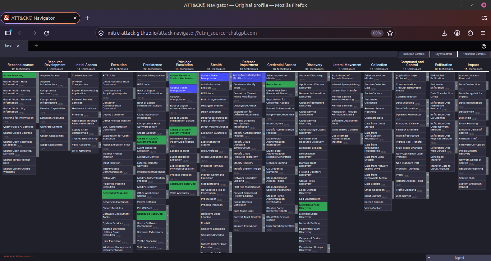

# MITRE ATT&CK Mapping

## 1. What is MITRE ATT&CK?

MITRE ATT&CK is a public knowledge base
that documents real-world attacker behaviour.

## 2. Tactic vs Technique

- Tactic = Why an attacker acts.
- Technique = How an attacker acts.

## 3. My Lab Mapping

| Lab | Tactic | Technique | ID |
|---|---|---|---|
| Nmap scan | Reconnaissance | Active Scanning | T1595 |
| Nmap services | Discovery | Network Service Discovery | T1046 |
| Sudo lab | Privilege Escalation | Sudo and Sudo Caching | T1548.003 |
| SUID lab | Privilege Escalation | Setuid and Setgid | T1548.001 |
| Cron lab | Persistence | Cron | T1053.003 |
| DVWA brute force | Credential Access | Brute Force | T1110 |

## 4. What I Learned

I learned that MITRE ATT&CK helps
security professionals understand attacker behaviour.

Tactics describe the goal of an attacker,
while techniques describe the method.

## 5. ATT&CK Navigator

I created a Navigator layer highlighting
the techniques I practised.

