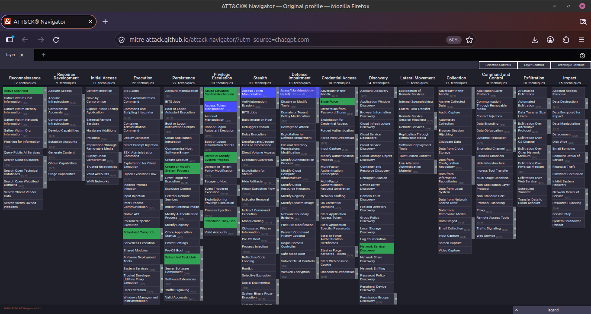

# MITRE ATT&CK Mapping

## What is MITRE ATT&CK?

MITRE ATT&CK is a public knowledge base
that explains how real-world attackers behave.

## Difference Between Tactics and Techniques

- Tactic = Why an attacker performs an action.
- Technique = How an attacker performs an action.

## My Lab Mapping

| My Lab | Tactic | Technique | ID |
|---|---|---|---|
| Nmap scanning | Reconnaissance | Active Scanning | T1595 |
| Nmap service discovery | Discovery | Network Service Discovery | T1046 |
| Sudo lab | Privilege Escalation | Sudo and Sudo Caching | T1548.003 |
| SUID lab | Privilege Escalation | Setuid and Setgid | T1548.001 |
| Cron lab | Persistence | Cron | T1053.003 |
| DVWA brute force | Credential Access | Brute Force | T1110 |

## What I Learned

I learned how MITRE ATT&CK categorises
real-world attacker behaviour.

I understand the difference between tactics
and techniques and how to map my practical labs.

## ATT&CK Navigator Screenshot

My highlighted techniques are shown below.

